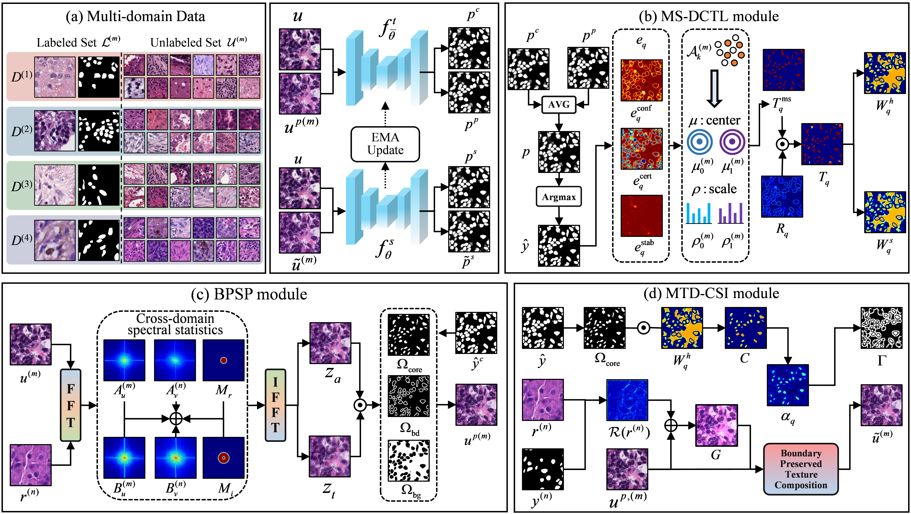

# CrossTrust

Implementation of Trust-Aware Cross-Domain Semi-Supervised Learning for Histopathology Nuclei Segmentation**.



*Overview of the teacher--student framework and its MS-DCTL, BPSP, and MTD-CSI modules.*

The training pipeline follows the three modules and objective described in the paper:

- `modules/ms_dctl.py`: Multi-Source Dynamic-Center Trust Learning (MS-DCTL)
- `modules/bpsp.py`: Boundary-Preserved Spectral Perturbation (BPSP)
- `modules/mtd_csi.py`: Morphology-Texture Decoupled Cross-Source Interaction (MTD-CSI)
- `train.py`: teacher--student training with supervised, trust-weighted, and mixed-image losses
- `evaluate.py`: per-dataset DC, JC, ASSD, and HD95 evaluation

This release intentionally excludes experimental branches not included in the paper objective, including patch-switch, reciprocal-view, student trust refinement, feature consistency, and auxiliary boundary losses.

## Setup

Use Python 3.10 or 3.11. Install a PyTorch/torchvision pair compatible with your CUDA installation, then install the requirements:

```bash
pip install -r requirements.txt
```

## Data

Edit `configs/crosstrust_four_domains.example.json` and set the dataset roots. Each root should contain paired binary-mask folders, for example:

```text
data/CPM17/
  train/img/  train/gt/
  val/img/    val/gt/
```

Image and mask filenames and dimensions must match. All nonzero mask pixels are treated as nuclei. The datasets are not redistributed in this repository.
The loader expects preprocessed image patches at the size used in the experiments (256 x 256); it does not perform whole-slide tiling or resizing.

## Training

Run from the repository root:

```bash
python train.py --config configs/crosstrust_four_domains.example.json \
  --label-ratio 10 --seed 42 --output runs/crosstrust_10pct_seed42
```

Defaults follow the explicitly reported settings: the repository's compact nnU-Net-style 2D backbone, 100 epochs, batch size 24, AdamW, and the reported BPSP/MTD-CSI schedules. The backbone is implemented locally in `networks/nnunet2d.py`. Use `--label-ratio 100` for the fully labeled setting; unlabeled losses are skipped when no unlabeled samples remain.

`best.pth` is selected by mean validation Dice across domains. `last.pth` stores the final epoch. Checkpoints contain student/teacher weights, optimizer state, MS-DCTL centers/scales, arguments, and validation Dice.

## Testing

Evaluate a checkpoint on the configured test splits with:

```bash
python evaluate.py --config configs/crosstrust_four_domains.example.json \
  --checkpoint runs/crosstrust_10pct_seed42/best.pth --split test
```

